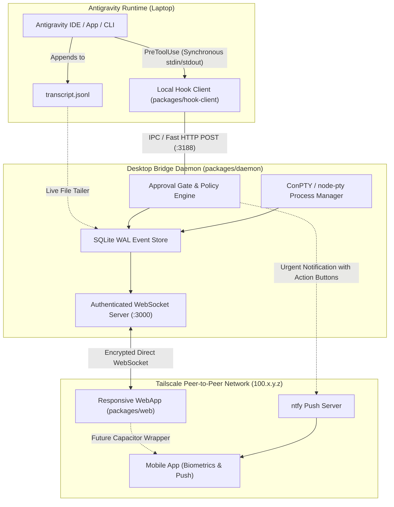
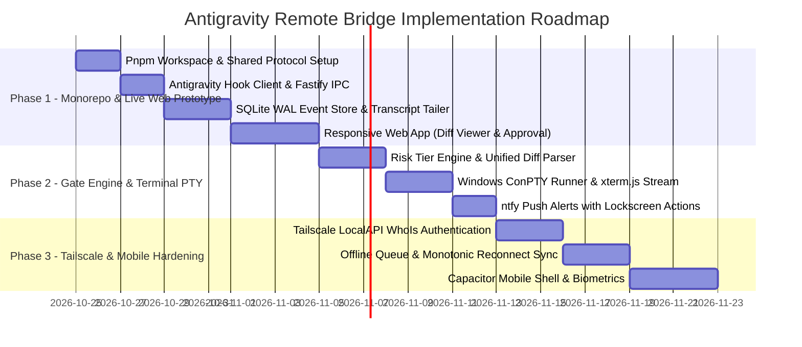

# Antigravity Remote Bridge & Mobile Approval Gate

## Comprehensive Master Implementation Plan (Updated & Enriched)

---

### Executive Summary & Technical Breakthrough

Our analysis of the internal Antigravity runtime and the cloned reference repositories (`study/`) confirms a reliable, official path forward: **we do not need brittle Chrome DevTools Protocol (CDP) DOM scraping or unofficial hacks to pause the agent.**

1. **Native Lifecycle Interception (`PreToolUse`)**:
   Antigravity implements an official Lifecycle Hook System (`.agents/hooks.json` or `~/.gemini/config/hooks.json`).
   When a tool executes (e.g., `write_to_file`, `replace_file_content`, `run_command`), Antigravity executes our hook client **synchronously** and pauses the agent execution loop until receiving a structured JSON decision on `stdout`:
   ```json
   {
     "decision": "allow" | "deny" | "ask" | "force_ask",
     "reason": "Rejected by mobile approval gate: Unsafe database migration."
   }
   ```
2. **Zero-Hosting, Pure Peer-to-Peer over Tailscale**:
   By connecting your laptop and phone via Tailscale (WireGuard mesh), **your laptop IS the server**.
   - No cloud database (MongoDB Atlas) or external hosting (Vercel/AWS) is required ($0 cost).
   - The Desktop Bridge Daemon runs locally on your laptop, binds to your private Tailscale IP (`100.x.y.z`), and serves both the API/WebSocket and the responsive Web App.
   - Your code diffs, terminal outputs, and credentials never touch a 3rd-party cloud.
   - Everything runs with sub-millisecond latency on local SQLite WAL mode and works seamlessly even when offline.

---

### Key Architectural Patterns Extracted from Cloned Repositories

Following our code review of the 6 cloned reference projects in `JarCode/study/`, we have integrated the following battle-tested engineering patterns into our design:

| Studied Repository                                        | Core Pattern Extracted                                  | How We Apply It to Our Bridge                                                                                                                                                                                                                                                                   |
| :-------------------------------------------------------- | :------------------------------------------------------ | :---------------------------------------------------------------------------------------------------------------------------------------------------------------------------------------------------------------------------------------------------------------------------------------------- |
| **`antigravity-sdk-python`** (`google/antigravity/hooks`) | **Decide vs. Inspect Taxonomy** & **TOCTOU Prevention** | We separate the gate into **Decide Hooks** (synchronously blocking, can sanitize/modify args) and **Inspect Hooks** (asynchronous observability). State is organized hierarchically: `SessionContext` $\rightarrow$ `TurnContext` $\rightarrow$ `OperationContext`.                             |
| **`better-sqlite3`** (`docs/performance.md`)              | **WAL Mode & Checkpoint Starvation Defense**            | We configure `journal_mode = WAL` and `synchronous = NORMAL` for microsecond write latency, use cached prepared statements for all queries, and schedule periodic `wal_checkpoint(RESTART)` to prevent unbounded WAL file growth.                                                               |
| **`ntfy`** (`docs/publish.md`)                            | **Interactive Lockscreen Action Buttons**               | We leverage `ntfy`'s HTTP push API with `actions` arrays. When an approval request is triggered, your phone displays **"Approve"**, **"Deny"**, and **"Review Diff"** buttons directly on the lockscreen notification. You can approve or reject with a single tap without opening the browser. |
| **`tailscale`** (`tsnet/tsnet.go` & `util/syspolicy`)     | **Zero-Trust Mutual Auth via LocalAPI WhoIs**           | The daemon queries Tailscale's local daemon (`/localapi/v0/whois?addr=<client_ip_port>`) upon incoming WebSocket connections to cryptographically verify device ownership and node identity with zero manual passwords or custom TLS certs.                                                     |
| **`ttyd`** (`src/protocol.c` & `server.c`)                | **PTY Framing & Window Resize Protocol**                | We implement `ttyd`'s compact frame protocol (`binary` vs `text`), window resize negotiation (`{ columns, rows }`), and strict host-origin headers to prevent cross-site WebSocket hijacking.                                                                                                   |
| **`xterm.js`** (`addons/`)                                | **Dynamic Terminal Fit & Web Links**                    | In our frontend, we integrate `@xterm/addon-fit` to dynamically adjust terminal dimensions on phone orientation changes, and `@xterm/addon-web-links` so local URLs (like `http://localhost:5173`) in terminal outputs are directly clickable.                                                  |

---

### Target System Architecture



---

### Complete Technology Stack

| Layer                     | Technology                                                 | Concrete Selection Details                                                                                        |
| :------------------------ | :--------------------------------------------------------- | :---------------------------------------------------------------------------------------------------------------- |
| **Monorepo Manager**      | Turborepo + pnpm workspaces                                | Manages `packages/shared`, `packages/hook-client`, `packages/daemon`, and `packages/web`.                         |
| **Shared Protocol**       | TypeScript + Zod                                           | Strict runtime schema validation across daemon, hook client, and web app.                                         |
| **Desktop Daemon**        | Node.js (v20+ LTS) + TypeScript                            | Fastify for high-speed hook IPC, `ws` for streaming, `node-pty` for ConPTY terminal control.                      |
| **Data Persistence**      | SQLite 3 via `better-sqlite3`                              | WAL mode (`PRAGMA journal_mode = WAL; PRAGMA synchronous = NORMAL;`). Microsecond reads/writes.                   |
| **Terminal & PTY**        | `node-pty` (ConPTY on Windows) + `tree-kill`               | True ANSI terminal allocation, regex progress extractors, and hard process-tree termination via `taskkill /T /F`. |
| **Network & Security**    | Tailscale (100.x.y.z binding) + LocalAPI WhoIs             | Peer-to-peer encrypted mesh. No public ports. Authenticates device identity directly via Tailscale.               |
| **Push Alerts**           | `ntfy` (ntfy.sh or self-hosted)                            | Immediate push alerts with interactive lockscreen buttons (`Approve`, `Deny`, `Review Diff`).                     |
| **Frontend UI (Phase 1)** | React 19 + Vite + Zustand + Vanilla/Tailwind CSS           | High-density desktop & mobile viewports, responsive diff viewer, glassmorphism aesthetic.                         |
| **Terminal Frontend**     | `xterm.js` + `@xterm/addon-fit` + `@xterm/addon-web-links` | Responsive, real-time terminal stream with automatic resize negotiation.                                          |
| **Mobile App (Phase 2)**  | Capacitor / React Native wrapper                           | Leverages the existing React frontend, adding WebAuthn biometric security and local push handling.                |

---

### Monorepo Structure

```text
JarCode/
├── .agents/
│   └── hooks.json                 <-- Antigravity PreToolUse hook configuration
├── packages/
│   ├── shared/                    <-- Shared contracts & types
│   │   ├── src/
│   │   │   ├── events.ts          <-- Typed event envelope & message schemas
│   │   │   ├── policies.ts        <-- Risk tier classifications & rules
│   │   │   ├── pty-protocol.ts    <-- Terminal resize & stream message types
│   │   │   └── index.ts
│   │   └── package.json
│   ├── hook-client/               <-- Binary executed by Antigravity hooks
│   │   ├── src/
│   │   │   └── index.ts           <-- Reads stdin, POSTs to Daemon, writes decision to stdout
│   │   └── package.json
│   ├── daemon/                    <-- Core Desktop Bridge Daemon
│   │   ├── src/
│   │   │   ├── db/                <-- SQLite connection & WAL management
│   │   │   ├── gate/              <-- Decide/Inspect taxonomy & risk policy engine
│   │   │   ├── pty/               <-- Windows ConPTY manager & output parsers
│   │   │   ├── tailer/            <-- Transcript tailer (transcript.jsonl)
│   │   │   ├── push/              <-- ntfy client with action button payloads
│   │   │   ├── auth/              <-- Tailscale LocalAPI WhoIs verifier
│   │   │   ├── server/            <-- Fastify IPC (:3188) + WebSocket server (:3000)
│   │   │   └── index.ts
│   │   └── package.json
│   └── web/                       <-- Responsive Web App (Desktop + Mobile)
│       ├── src/
│       │   ├── components/        <-- Unified Diff Viewer, Terminal, Approval Modal
│       │   ├── store/             <-- Zustand store with event replay & lastSeq tracking
│       │   ├── hooks/             <-- WebSocket connection & auto-reconnect hook
│       │   ├── App.tsx
│       │   └── main.tsx
│       ├── index.html
│       ├── vite.config.ts
│       └── package.json
├── study/                         <-- Reference repos (antigravity-sdk, better-sqlite3, etc.)
├── pnpm-workspace.yaml
├── turbo.json
└── package.json
```

---

### Database Schema (Local SQLite WAL)

Applying `better-sqlite3` best practices (`journal_mode = WAL`, `synchronous = NORMAL`):

```sql
-- 1. Sessions table
CREATE TABLE IF NOT EXISTS sessions (
  id TEXT PRIMARY KEY,               -- conversationId
  workspace_path TEXT NOT NULL,
  status TEXT NOT NULL DEFAULT 'active', -- active, waiting_approval, idle, completed
  created_at INTEGER NOT NULL,
  updated_at INTEGER NOT NULL
);

-- 2. Monotonic Append-Only Event Log
CREATE TABLE IF NOT EXISTS events (
  id TEXT PRIMARY KEY,               -- UUIDv4
  session_id TEXT NOT NULL,
  seq INTEGER NOT NULL,              -- Monotonically increasing per session (1, 2, 3...)
  ts INTEGER NOT NULL,               -- Epoch ms
  source TEXT NOT NULL,              -- 'agent' | 'daemon' | 'client' | 'hook'
  type TEXT NOT NULL,                -- 'agent.thought' | 'gate.approval_requested' | etc.
  payload TEXT NOT NULL,             -- JSON stringified payload
  FOREIGN KEY (session_id) REFERENCES sessions(id)
);
CREATE INDEX IF NOT EXISTS idx_events_session_seq ON events (session_id, seq);

-- 3. Pending Approvals Queue
CREATE TABLE IF NOT EXISTS pending_approvals (
  id TEXT PRIMARY KEY,               -- approvalId (UUID)
  session_id TEXT NOT NULL,
  step_idx INTEGER NOT NULL,
  tool_name TEXT NOT NULL,           -- 'write_to_file', 'run_command', etc.
  risk_tier INTEGER NOT NULL,        -- 0 (Auto), 1 (Standard), 2 (High Risk)
  summary TEXT NOT NULL,
  payload TEXT NOT NULL,             -- Full toolCall args + diff
  status TEXT NOT NULL DEFAULT 'pending', -- 'pending', 'approved', 'rejected', 'timed_out'
  feedback TEXT,                     -- Optional feedback on rejection
  created_at INTEGER NOT NULL,
  expires_at INTEGER NOT NULL
);
CREATE INDEX IF NOT EXISTS idx_pending_status ON pending_approvals (status);
```

---

### Synchronous Hook Interception Workflow

1. **Antigravity triggers tool**: Agent decides to run `replace_file_content` or `run_command`.
2. **Hook Execution**: Antigravity invokes the command in `.agents/hooks.json`:
   ```bash
   node ./packages/hook-client/dist/index.js
   ```
3. **Payload over `stdin`**: The hook receives:
   ```json
   {
     "conversationId": "abf018be-2f73-4f42-b54c-c8b493daa487",
     "stepIdx": 14,
     "toolCall": {
       "name": "write_to_file",
       "args": { "TargetFile": "...", "CodeContent": "..." }
     },
     "transcriptPath": "..."
   }
   ```
4. **Fast IPC Call**: `hook-client` sends `POST http://127.0.0.1:3188/api/hook/pre-tool` to the daemon.
5. **Policy Evaluation**:
   - **Tier 0 (Auto-allow)**: Daemon responds `{ "decision": "allow" }` in <5ms.
   - **Tier 1 / 2 (Review required)**:
     - Daemon creates a pending approval record and broadcasts `gate.approval_requested` over WebSocket to the Web App.
     - Daemon triggers an `ntfy` push notification with interactive lockscreen buttons:
       - `[Approve]` $\rightarrow$ `POST http://100.x.y.z:3000/api/gate/approve?id=...`
       - `[Review Diff]` $\rightarrow$ `http://100.x.y.z:3000/#diff-...`
     - The HTTP connection between `hook-client` and daemon stays open (holding the agent paused).
6. **User Decision**:
   - You tap **Approve** (or **Reject** with feedback) from your phone.
   - Daemon resolves the pending HTTP request with `{ "decision": "allow" }` or `{ "decision": "deny", "reason": "..." }`.
   - `hook-client` prints the JSON response to `stdout` and exits with code 0.
   - Antigravity receives the decision on `stdout` and either executes the tool or revises its plan based on your feedback.

---

### Terminal Streaming & ConPTY Management (`ttyd` + `xterm.js`)

1. **ConPTY Process Allocation**: Approved terminal commands run inside Windows ConPTY via `node-pty`.
2. **Dynamic Window Resizing**:
   - In the frontend, `@xterm/addon-fit` calculates the optimal `cols` and `rows` based on the mobile device's screen size or viewport change.
   - Client sends `{ type: 'pty.resize', cols: 80, rows: 24 }`.
   - Daemon calls `ptyProcess.resize(cols, rows)` immediately.
3. **Output Stream Filtering**:
   - Output is parsed with lightweight regex matchers for package managers (`npm`, `pnpm`, `cargo`, `gradle`, `pytest`).
   - High-level progress milestones are emitted as `terminal.milestone` (e.g. `Bundled 34 assets in 180ms`).
   - Raw terminal ANSI bytes are streamed to `xterm.js` for full VT100 fidelity.
4. **Instant Kill Switch**:
   - If a command hangs or enters an infinite loop, you click **Kill Process** in the web app.
   - Daemon immediately executes `taskkill /pid <PID> /T /F` (killing the entire child process tree on Windows) in under 500ms.

---

### Phased Roadmap



#### Detailed Phase Deliverables:

- **Phase 1: Foundation & Web Prototype (Goal: Working end-to-end approval loop)**
  - Scaffold monorepo (`packages/shared`, `packages/hook-client`, `packages/daemon`, `packages/web`).
  - Wire `.agents/hooks.json` to `hook-client`.
  - Implement daemon Fastify IPC server + SQLite WAL database.
  - Tail `transcript.jsonl` to stream thinking tokens and tool calls live.
  - Build responsive React Web App displaying the live transcript and a modal that pops up with "Approve / Deny" when a file write is attempted.
  - **Milestone 1 Test**: Run a prompt on the laptop $\rightarrow$ Antigravity attempts to create a file $\rightarrow$ agent pauses $\rightarrow$ Web App prompts you $\rightarrow$ you click "Approve" $\rightarrow$ file is created!

- **Phase 2: Gate Engine, Terminal PTY & Push Notifications**
  - Implement Risk Tiers (Auto-allow reads/tests, Review writes/installs, Block destructive commands).
  - Syntax-highlighted unified diff viewer (colorized line additions/removals).
  - Connect `node-pty` and `xterm.js` with responsive `@xterm/addon-fit`.
  - Integrate `ntfy` push alerts with actionable lockscreen buttons.

- **Phase 3: Tailscale Binding & Mobile Hardening**
  - Bind daemon to Tailscale IP (`100.x.y.z`), verify connecting clients via Tailscale LocalAPI WhoIs.
  - Implement monotonic sequence sync (`lastSeq`) for seamless reconnection when waking the phone.
  - Package the web app with Capacitor for native mobile biometrics (FaceID/TouchID).

---

### Next Action

We are ready to initialize the monorepo workspace and create the foundational packages (`shared`, `daemon`, `hook-client`, and `web`).
